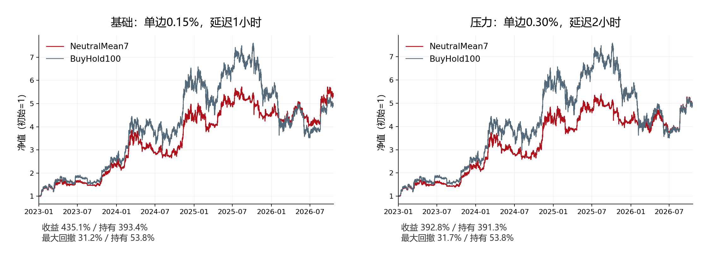
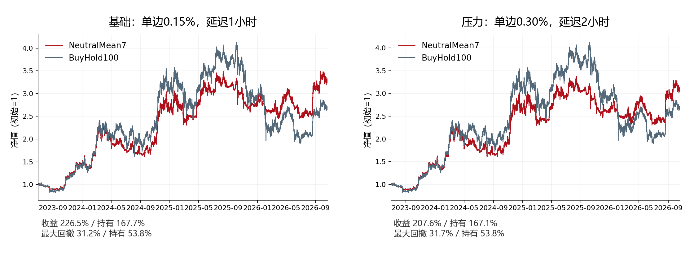
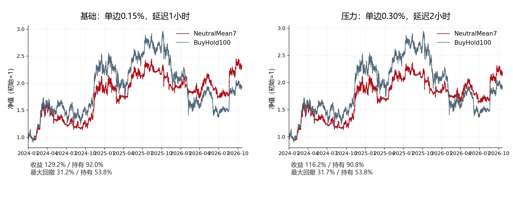
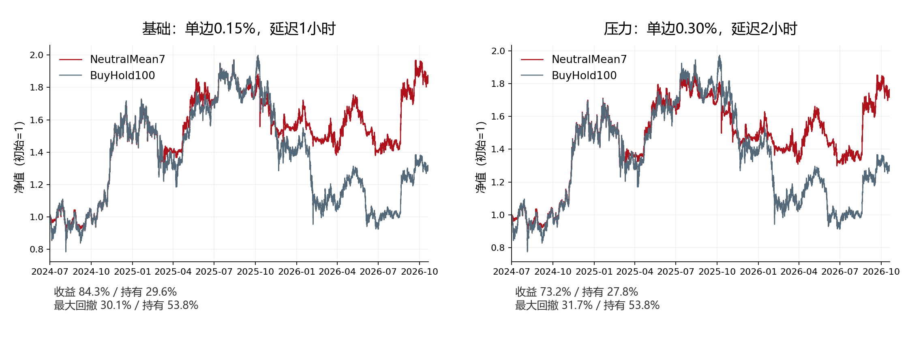
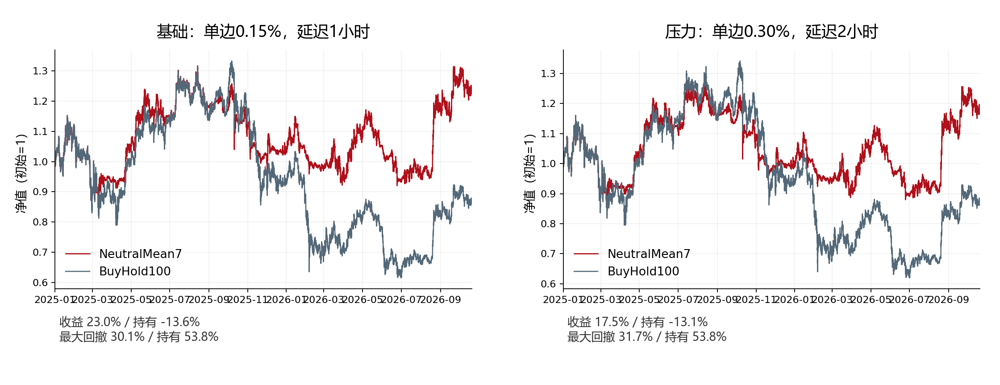
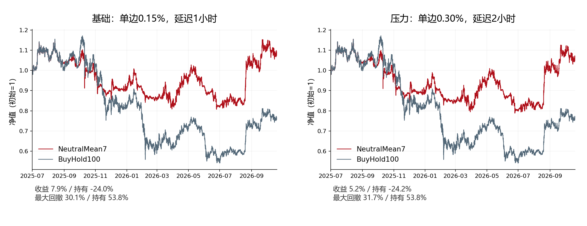
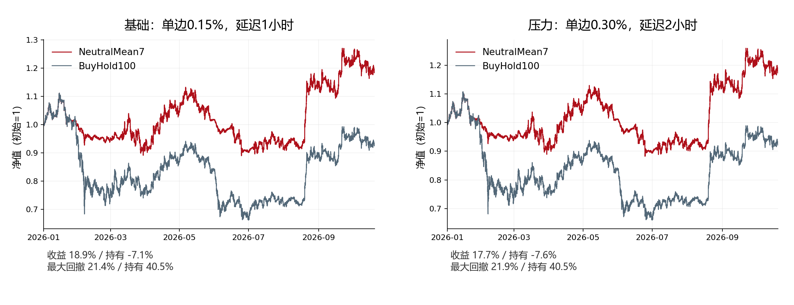
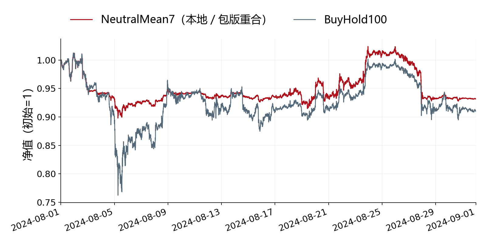

# NeutralMean7发布验证与多起点回测

## 发布范围

NeutralMean7.qstrat为自定义ZIP容器，内含源码、原始行情状态种子、冻结模型JSON、安装器和SHA256清单。Freqtrade没有原生.qstrat导入器；通过随附安装器部署到标准用户策略目录。安装后的类名为NeutralMean7Portable，压力别名为NeutralMean7PortableLag2。安装不会启动交易服务。
包内无研究目录绝对路径、历史目标仓位日程、交易所密钥或自动实盘指令。生产版从已完成行情计算新目标；截至原种子之后的功能测试使用合成小时行情，不作为未来收益证据。
冻结模型使用原StandardScaler与Ridge的完整float64参数导出，推断仅需numpy，无需加载pickle或运行时依赖sklearn。环境锁定为测试过的Python 3.13.12、Freqtrade 2026.9、numpy 2.4.6、pandas 3.0.6、pyarrow 25.0.1；未声称已测试所有系统和版本。

## 功能等价性

- 原模型与导出模型最大预测绝对误差：0.0；全部历史日目标权重完全相同。
- 7个起点×2个成本/延迟情景，共14组主引擎回测；另有2024年8月5分钟明细对照，共15组本地/包版本对照均通过。
- 457笔经济订单核对时刻、方向、数量、价格和标签，逐项完全相同（重叠窗口重复计数，并非独立或唯一订单数）。
- 所有主回测按原始5分钟报价独立重建现金、数量、费用与总资产，终值与引擎误差小于0.1 USDT；现金与现货敞口约束通过。
- 10项历史前缀/未来扰动检查、10个滞后回调时点、新行情计算及重启缓存恢复通过；篡改单个包文件后安装器在写文件前拒绝安装。
- 校验是包内SHA256完整性检查，不是数字签名。完整包SHA256另列于本文与最终交付清单。
- 首次独立进程导入没有加载原研究策略模块。验证用的ResearchReference.py只存在测试目录，不在发布包中。

## 固定回测口径

固定起点：2023-01-01、2023-07-01、2024-01-01、2024-07-01、2025-01-01、2025-07-01、2026-01-01；共同终点2026-10-20 07:00 UTC。每次初始10000 USDT、空账户交易状态，使用起点之前可用的历史特征，不重训。Binance BTC/USDT现货，只做多、现金零收益、无杠杆。
基础单边费用0.15%，至少1小时信息滞后、UTC01:00；压力单边0.30%，至少2小时滞后、UTC02:00。统一以费用参数扣除，没有额外滑点或订单簿冲击/排队模型。主引擎1小时；独立风险盯市使用5分钟开盘价，包含浮亏，非精确逐笔最坏回撤。全部端点强制清仓并计费。
BuyHold100在每次起点的首个预设执行时点买入，扣买入费用，之后持有到相同端点并扣卖出费用。没有等待主动策略首次信号才让基准入场。CAGR使用整个窗口的日历时长。主引擎与实际明细的对照范围分开披露，不冒称14组均跑过全历史5分钟明细引擎。
为避免实时市场信息接口超时，后续窗口共用冻结的币安BTCUSDT公开exchangeInfo与CCXT标准解析器；成交/费用/策略引擎未替换。用2026起点压力窗口核对联网与快照方式，经济订单及终值完全一致。快照为研究当日交易规则，不代表回放每个历史日期的交易所规则变迁。

## 全部14个窗口

| 起点 | 情景 | 策略收益 | 持有收益 | 策略回撤 | 持有回撤 | 期末净值/持有 | 目标 |
|---|---|---:|---:|---:|---:|---:|---|
| 2023-01-01 | base | 435.10% | 393.44% | 31.25% | 53.84% | 108.44% | 通过 |
| 2023-07-01 | base | 226.54% | 167.68% | 31.25% | 53.84% | 121.99% | 通过 |
| 2024-01-01 | base | 129.20% | 92.03% | 31.25% | 53.84% | 119.36% | 通过 |
| 2024-07-01 | base | 84.26% | 29.61% | 30.07% | 53.84% | 142.17% | 通过 |
| 2025-01-01 | base | 23.04% | -13.60% | 30.07% | 53.84% | 142.41% | 通过 |
| 2025-07-01 | base | 7.92% | -24.04% | 30.07% | 53.84% | 142.07% | 通过 |
| 2026-01-01 | base | 18.89% | -7.11% | 21.43% | 40.49% | 127.99% | 通过 |
| 2023-01-01 | stress | 392.84% | 391.31% | 31.72% | 53.84% | 100.31% | 通过 |
| 2023-07-01 | stress | 207.64% | 167.08% | 31.72% | 53.84% | 115.19% | 通过 |
| 2024-01-01 | stress | 116.23% | 90.83% | 31.72% | 53.84% | 113.31% | 通过 |
| 2024-07-01 | stress | 73.24% | 27.78% | 31.72% | 53.84% | 135.58% | 通过 |
| 2025-01-01 | stress | 17.46% | -13.13% | 31.72% | 53.84% | 135.21% | 通过 |
| 2025-07-01 | stress | 5.22% | -24.16% | 31.72% | 53.84% | 138.74% | 通过 |
| 2026-01-01 | stress | 17.75% | -7.55% | 21.93% | 40.49% | 127.36% | 通过 |

预先目标：期末净值至少为持有95%，最大回撤至多为持有80%。基础7/7，压力7/7通过。本轮未用这些结果重新优化参数。

## 曲线（全部起点、基础与压力）

### 2023-01-01

### 2023-07-01

### 2024-01-01

### 2024-07-01

### 2025-01-01

### 2025-07-01

### 2026-01-01

## 额外5分钟明细月对照

2024-08-01至2024-09-01：策略收益-6.85%，持有收益-9.05%；策略最大回撤11.29%；5笔订单与本地完全相同。该负收益月用于执行精度复核，不用于择优或改参数。

## 交易规则与运行边界

16个日线特征预测未来7日经波动标准化收益；最近7个已知预测均值为正或48日均线±2%缓冲趋势看多时，BTC目标99.5%；二者都弱时25%。初始无持仓时，防守状态也可能按25%目标买入。权重偏差小于3个百分点不调整，费用及最小订单约束会使实际权重偏离目标。
滞后24小时跌幅达到10%时，72小时禁止加仓，仍允许每日减仓，不机械强制全部压至25%。没有套整体80%年化波动预算，不承诺最大回撤。常规信号不完全清仓；引擎仍保留-99%灾难止损。
状态种子是原始小时行情，不是未来目标。计算时按时间戳排除评估时刻之后的种子行；后续live/dry-run会扩展用户目录的neutralmean7_state/history_1h.feather。保留缓存跨重启；长时间停机如出现未连接的小时历史缺口，先补齐数据再运行。
## 局限与风险

2023年以后是反复查看过的开发数据。模型只用2023年前训练不等于组合规则已在2023年前确定；7个起点共享同一大段未来行情，不是7次独立样本外检验。此前邻近3日/14日窗口及较早终点出现失败；主区间相对持有净值曾降至约70%。本轮结果不能证明稳定前向超额收益。
包的功能一致性只在所列依赖、数据、配置和框架上验证；其他交易所、资金规模、成交冲击和实时中断可能改变结果。未启动实盘，也未将合成功能测试当作真实前向收益。

## 校验与证据

发布包SHA256：`b81b9ca1fa73f9359b4ecf652fee19c67da41a4b6799c1507e40a03767fc92da`。
关键文件：SPEC.md、bundle_functional_validation.json、all_engine_parity.json、cash_order_audit.json、economic_orders_comparison.json、metadata_parity.json。命令与原始成交ZIP保留于同研究目录。
